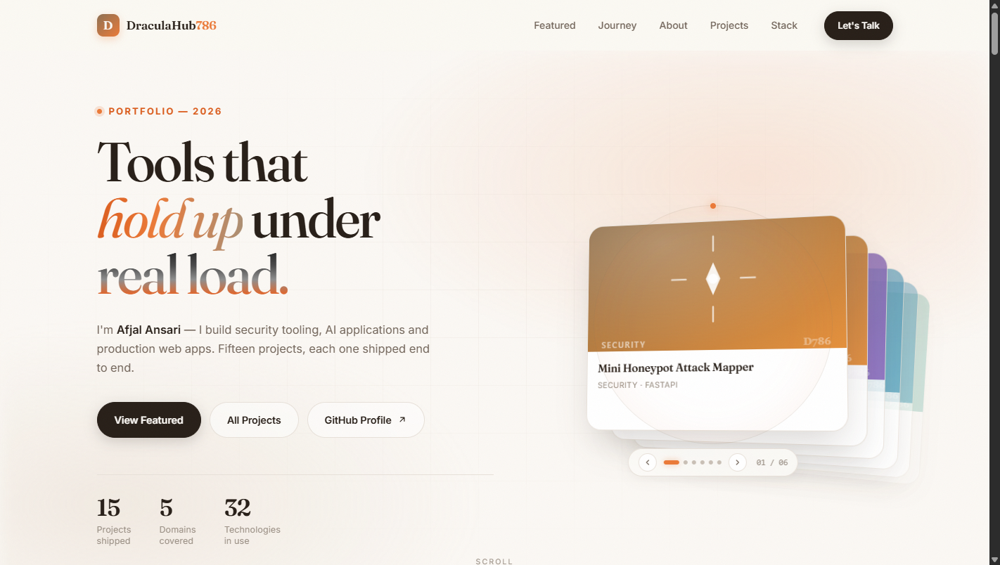
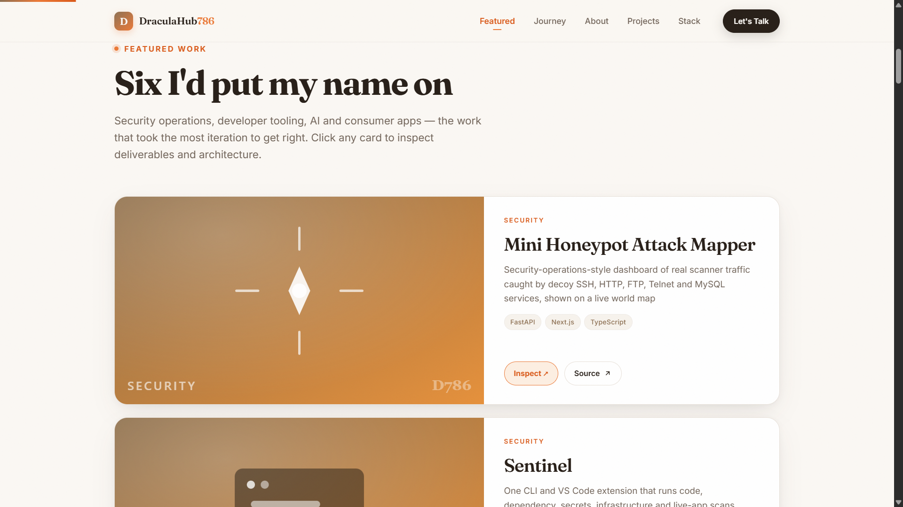
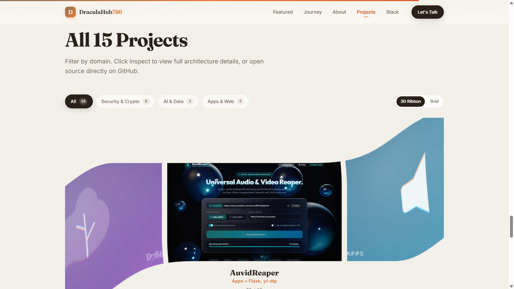
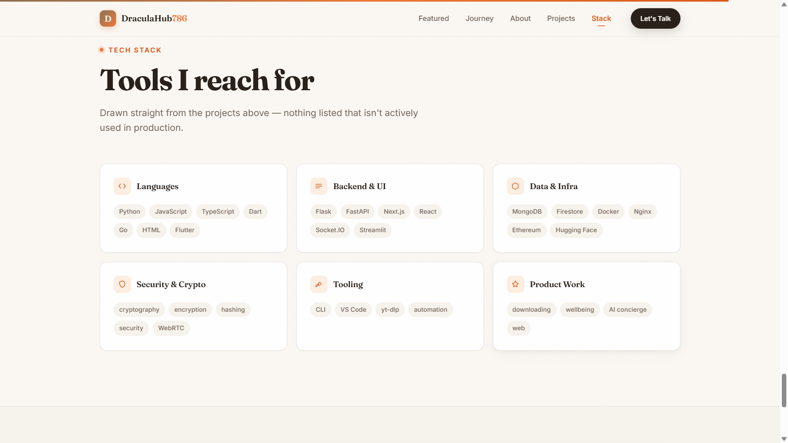
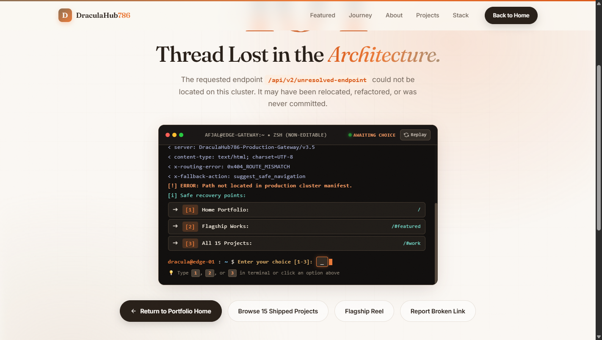

# DraculaHub786 — Engineering Portfolio

<div align="center">

[](https://nlpdigitox.me)
[](https://github.com/DraculaHub786)
[](https://nlpdigitox.me)
[](LICENSE)

<br/>

### **Afjal Ansari**
**DevSecOps Engineer • Security Researcher • AI & Full-Stack Systems Developer**

*High-performance web architecture, security automation, applied AI models, and production systems designed to hold up under real load.*

[**Explore Live Deployment (nlpdigitox.me) »**](https://nlpdigitox.me)

</div>

---

## ⚡ Overview

This repository hosts the source code for the official portfolio of **Afjal Ansari** ([@DraculaHub786](https://github.com/DraculaHub786)), accessible live at **[nlpdigitox.me](https://nlpdigitox.me)**.

Designed with an unapologetic focus on craftsmanship and engineering rigor, the site delivers a high-fidelity visual experience built on **pure Vanilla web technologies** — zero heavy frontend frameworks, zero build steps, and zero runtime bloat.

### 🎯 Key Engineering Highlights
- **100% Vanilla Foundation**: Built exclusively with HTML5, CSS3, and modern ES6+ JavaScript.
- **3D Liquid Ribbon Carousel**: Interactive WebGL2 canvas powered by OGL with custom shaders and touch/drag physics.
- **3D Sticky Docking Stack**: Scroll-driven kinetic card pile where featured cards dock and recede in 3D perspective space.
- **Interactive DevSecOps 404 Terminal**: Real-time HTTP curl telemetry simulation with natural packet delays and keyboard-driven recovery navigation.
- **Single Source of Truth**: Dynamic data-driven architecture rendering 15 projects on the fly from a decoupled `projects.json` manifest.

---

## 📊 Technical Stats & Metrics

<div align="center">

| Metric | Value | Description |
|:---|:---:|:---|
| **Shipped Projects** | `15` | Production-ready applications, security tools, and AI engines |
| **Engineering Domains** | `5` | Security, Cryptography, Applied AI, Mobile Apps, Full-Stack Web |
| **Production Technologies** | `32` | Actively used languages, frameworks, cloud services, and security tooling |
| **Runtime Dependencies** | `0` | No React, Vue, or Webpack overhead — instant load with pure native browser APIs |
| **Animation Performance** | `60 FPS` | GPU-accelerated compositing with `transform: translate3d` and WebGL2 shaders |
| **Accessibility & Motion** | `100%` | Full keyboard trap prevention, ARIA semantics, and `prefers-reduced-motion` compliance |

</div>

### 📁 Domain Breakdown

```
Portfolio Architecture (15 Total Projects)
├── 🛡️ Security & DevSecOps       [4 Projects]  (Honeypot Attack Mapper, Sentinel Scanner, SIEM Platform, Secure File Sharing)
├── 🔐 Cryptography & Web3        [4 Projects]  (Crypto Wallet Testnet, Crypto Simulation, Cryptographic Algorithms, Password Cracking)
├── 📱 Mobile & Desktop Apps      [3 Projects]  (NLP-Digitox Android, AuvidReaper Engine, Error Sound Alert Extension)
├── 🌐 Full-Stack Web Systems     [2 Projects]  (DecentralChat E2E, Nur-e-Haya Hotel Management System)
└── 🧠 Applied AI & Data          [2 Projects]  (SkillGap AI [DistilBERT], AQI Health Prediction Engine)
```

---

## 🖥️ Visual Walkthrough & Interface Architecture

### 01. Hero & Interactive 3D Project Fan
The hero section features bold editorial typography (`Fraunces` + `Plus Jakarta Sans`), a dynamic live status indicator, real-time counters, and a rotating 3D featured project deck with synchronized indicators.

<div align="center">
  
</div>

<br/>

### 02. Flagship Works — 3D Sticky Docking Stack
Featured flagship projects dock seamlessly beneath the sticky navigation bar upon scroll. Each card scales down and recedes in 3D space as subsequent projects cascade over them, creating tactile visual depth.

<div align="center">
  
</div>

<br/>

### 03. All 15 Projects — WebGL2 Liquid Ribbon Carousel
Hardware-accelerated liquid ribbon carousel rendering all 15 projects in an endless 3D cylindrical wave. Filter chips dynamically prune the catalog with instant counter recalculations (`01/15`, `01/08`, `01/05`, `01/02`) and smooth toggle between 3D Ribbon and responsive grid modes.

<div align="center">
  
</div>

<br/>

### 04. Production Tech Stack Matrix
A comprehensive breakdown of all 32 active tools, categorizing languages, backend/frontend frameworks, data systems, cloud infrastructure, and security tooling directly utilized in shipped repositories.

<div align="center">
  
</div>

<br/>

### 05. DevSecOps Telemetry Terminal (Interactive 404)
Custom simulated edge gateway console on `404.html`. Mimics a low-level packet stream, logs HTTP headers and route mismatch errors, and awaits interactive human input via both mouse clicks and keyboard shortcuts (`1`, `2`, `3`) to safely route users back to verified endpoints.

<div align="center">
  
</div>

---

## 🛠️ Tech Stack & Systems Matrix

| Architectural Layer | Technologies & Tools |
|:---|:---|
| **Core Languages** | `Python` • `Go` • `TypeScript` • `JavaScript (ES6+)` • `Dart` • `HTML5` • `CSS3` |
| **Backend & Services** | `FastAPI` • `Flask` • `Next.js` • `Node.js` • `Socket.IO` • `Streamlit` |
| **Frontend & Graphics** | `Vanilla Web Components` • `WebGL2 (OGL)` • `React` • `TailwindCSS` • `Canvas API` |
| **Data & Persistence** | `MongoDB` • `Google Firestore` • `SQLite` • `Redis` |
| **Security & DevSecOps** | `Sentinel CLI` • `Decoy Honeypots` • `SIEM Log Aggregation` • `SAST / DAST` • `Nginx` • `Docker` |
| **Cryptography & Web3** | `Ethereum Testnets` • `MetaMask Integration` • `WebRTC P2P` • `AES-256` • `RSA` • `SHA-256` |
| **Mobile & Tools** | `Flutter (Android)` • `VS Code Extension API` • `yt-dlp` • `Git` • `Linux / Bash` |

---

## 🗂️ Repository Structure

```
DraculaHub786.github.io/
├── index.html               # Main single-page portfolio application
├── styles.css               # Design tokens, responsive grid, 3D sticky stack styles
├── script.js                # Core controller: project rendering, filters, modals, nav
├── flex-carousel.js         # WebGL2 / OGL liquid ribbon 3D carousel engine
├── projects.json            # Decoupled project catalog (single source of truth)
├── 404.html                 # Interactive DevSecOps terminal fallback experience
├── CNAME                    # Custom production domain pointer (nlpdigitox.me)
├── robots.txt               # SEO indexing directives & sitemap location
├── sitemap.xml              # Search engine index manifest
├── assets/
│   ├── favicon.svg          # Vector browser brand icon
│   ├── og.png               # Social graph preview card (1200×630)
│   ├── img/projects/        # Vector project artwork & screenshots
│   └── screenshots/         # High-resolution portfolio showcase imagery
│       ├── 01-hero-overview.png
│       ├── 02-featured-stack.png
│       ├── 03-work-ribbon.png
│       ├── 04-tech-stack.png
│       └── 05-terminal-404.png
└── tools/                   # DevSecOps CDP verification, geometry audit, and tiling scripts
    ├── verify.js            # Automated CDP headless browser validation
    ├── audit.js             # Geometric layout and image resource auditor
    ├── shoot.js             # Automated high-res viewport screenshot generator
    └── make-tiles.js        # Dynamic SVG tile builder
```

---

## ⚙️ Adding or Editing Projects

To modify or add projects, edit `projects.json`. The application dynamically queries and renders cards and carousel ribbons at runtime with zero manual markup edits required:

```json
{
  "title": "Sentinel Unified Scanner",
  "category": "Security",
  "featured": true,
  "desc": "One CLI and VS Code extension that unifies code, dependency, secret, and infra scans.",
  "tags": ["Go", "TypeScript", "CLI", "DevSecOps"],
  "github": "https://github.com/DraculaHub786/DevSecOps-Unified-Scanner",
  "live": "none",
  "image": "/assets/img/projects/sentinel-terminal.svg"
}
```

### Category & Filter Mapping

| Filter Chip | Category Match | Projects | URL Deep Link |
|:---|:---|:---:|:---|
| **All Projects** | `Security`, `Crypto`, `AI`, `Apps`, `Web` | `15` | `https://nlpdigitox.me/#work` |
| **Security & Crypto** | `Security`, `Crypto` | `8` | `https://nlpdigitox.me/?cat=security#work` |
| **Apps & Web** | `Apps`, `Web` | `5` | `https://nlpdigitox.me/?cat=apps#work` |
| **AI & Data** | `AI` | `2` | `https://nlpdigitox.me/?cat=ai#work` |

---

## 💻 Local Development & Verification

Because the portfolio fetches `projects.json` dynamically via `fetch()`, it requires a local HTTP server to avoid CORS file protocol restrictions:

### 1. Launch Local Server
```bash
# Using Python 3 built-in server (recommended)
python -m http.server 8085

# Or using Node.js npx serve
npx serve . -p 8085
```
Open **`http://localhost:8085`** in your browser.

### 2. Run Automated Quality Assurance
The `tools/` directory includes Chrome DevTools Protocol automation scripts to verify geometric stability, anchor integrity, and DOM performance:

```bash
# Run 11 automated functional CDP assertions
node tools/verify.js http://localhost:8085/

# Audit layout geometry and asset response health
node tools/audit.js http://localhost:8085/
```

---

## ♿ Accessibility & Performance Commitments

- **Strict Focus Control**: Full keyboard accessibility across all interactive cards, filters, and modal dialogs with visible focus rings.
- **Motion Reduction**: Honors `prefers-reduced-motion: reduce` by disabling 3D perspective stacks and WebGL ribbon displacement, rendering clean static fallbacks immediately.
- **Zero CLS (Cumulative Layout Shift)**: Pre-allocated image dimensions and structural skeleton placeholders prevent layout jumps during asynchronous data loading.
- **Lightweight Footprint**: Sub-second First Contentful Paint (FCP) achieved by omitting heavy client-side frameworks.

---

## 📬 Contact & Connect

**Afjal Ansari**  
- **Email**: [afjalansari29162@gmail.com](mailto:afjalansari29162@gmail.com)  
- **Portfolio**: [nlpdigitox.me](https://nlpdigitox.me)  
- **GitHub**: [@DraculaHub786](https://github.com/DraculaHub786)  

<br/>

<div align="center">
  <sub>Designed & Developed with precision by <b>Afjal Ansari</b> © 2026 DraculaHub786. All rights reserved.</sub>
</div>
